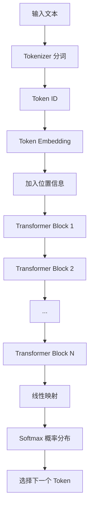

# 核心概念

## LLM

本章按「机制 → 构件 → 推理与采样 → 约束 → 能力与边界」组织：

1. LLM 是什么
2. Token 是什么
3. Transformer 是什么
4. 什么是推理
5. Temperature、Top-p 与 Top-k
6. 上下文窗口
7. LLM 为什么表现得像是在理解
8. LLM 的主要能力
9. LLM 的主要局限
10. LLM、搜索引擎与数据库的区别

### 1. LLM 是什么

LLM（Large Language Model，大语言模型）是一类在海量文本上训练的神经网络模型，主流形态多为 **Decoder-only Transformer**。它接收文本输入，并基于上下文生成后续文本。

从底层机制看，LLM 的核心任务是：

> 根据已有的 Token 序列，预测下一个 Token 的概率分布。

**Token** 是模型处理文本的最小单位，不等于字或词。一段中文可能被切成多个 Token；模型还有 **上下文窗口**（Context Window）限制，超过长度的内容无法同时参与计算。后文会分别展开。

例如，输入：

```text
天空是
```

模型会先把输入拆成 Token，再计算「下一个 Token」的概率分布。下面为便于理解，把候选写成完整词（真实场景中它们也可能对应多个 Token）：

```text
蓝色：60%
灰色：20%
晴朗：10%
其他：10%
```

模型再按采样策略选出一个 Token，例如：

- **Greedy**：每次选概率最高的
- **Temperature**：调节随机性，温度越高越多样
- **Top-p / Top-k**：只从概率较高的候选子集中采样

选出后把它加入上下文，继续预测下一个 Token。这个过程不断重复，最终形成句子、文章或代码。

```text
输入文本
   ↓
拆分为 Token
   ↓
计算下一个 Token 的概率
   ↓
按策略选择并生成 Token
   ↓
将新 Token 加入上下文
   ↓
重复上述过程，直到生成结束
```

这个过程就是**自回归生成**（Autoregressive Generation）。

从概率上看，一段完整文本可写成链式分解：

```text
P(完整文本)
= P(Token₁)
× P(Token₂ | Token₁)
× P(Token₃ | Token₁, Token₂)
× ...
```

实际对话或补全时，通常已有前缀（Prompt），模型做的是**条件生成**：

```text
P(输出 | 输入)
= P(y₁ | 输入)
× P(y₂ | 输入, y₁)
× P(y₃ | 输入, y₁, y₂)
× ...
```

它有两个重要特点：

- **逐个生成**：后一个 Token 依赖前面的 Token，标准自回归 LLM 通常不能一次并行生成完整答案。
- **错误会累积**：前面选中的 Token 会影响后续生成方向。

训练时，在已知真实前文的前提下，可以并行计算多个位置的预测损失；但实际生成时，因为下一个 Token 依赖刚生成的结果，通常需要按顺序进行。

对 Agent 而言：LLM 本身主要负责理解与生成文本；调用工具、保持任务状态、多步执行，要靠外围的编排、记忆与工具系统来完成。

### 2. Token 是什么

Token 是模型处理文本时使用的基本单位。它不一定等于一个完整的字或单词，也可能是：

- 一个汉字
- 一个英文单词
- 单词的一部分
- 标点符号
- 空格或特殊符号

例如：

```text
unbelievable → un + believ + able
```

分词器不能简单地只按字符或完整单词切分，因为 Token 粒度需要在**词表规模、序列长度、语义表达能力和未登录词处理能力**之间取得平衡：

- **字符级分词：** 词表规模相对可控，几乎不会出现未登录字符，但会产生更长的 Token 序列，增加模型的计算量，并使模型需要通过更多位置组合出词语和语义。
- **词级分词：** 可以缩短常见文本的序列长度，但自然语言中的词形、专有名词和组合方式极其丰富，容易导致词表规模过大，并产生大量未登录词（Out-of-Vocabulary，OOV）。

现代 LLM 通常采用 BPE、WordPiece 或 Unigram 等**子词分词算法**。这些算法会将高频字符序列编码为单个 Token，并将低频词、派生词或未知词拆分成更小的子词单元。需要注意的是，Token 是由分词器根据统计规律构建的编码单元，并不一定对应语言学意义上的完整“词”。

不同模型的分词算法、训练语料和词表不同，因此同一段文本在不同模型中可能得到不同的 Token 序列和数量。

以下换算只能用于粗略估算，实际数量应以目标模型的分词器结果为准：

- 英文文本中，1 Token 通常约对应 3～4 个字符。
- 中文文本中，1 Token 通常约对应 1～2 个汉字，但会受到模型词表、文本内容以及中英文混排比例的显著影响。

Token 数量会直接影响：

- 模型能读取的内容长度
- 请求处理时间
- API 调用费用
- 输出内容的最大长度

### 3. Transformer 是什么

Transformer 是一种用于处理序列数据的神经网络架构，由论文《Attention Is All You Need》在 2017 年提出。现代 LLM 大多建立在 Transformer 或其变体之上。

在 Transformer 出现之前，文本任务通常使用 RNN（Recurrent Neural Network，循环神经网络）或 LSTM（Long Short-Term Memory，长短期记忆网络）按顺序处理 Token。由于后一个位置依赖前一个位置的计算结果，这类架构难以充分并行训练，也较难保留距离很远的信息。

Transformer 的核心改进是使用 Attention（注意力）直接建立序列中不同位置之间的关系，使模型能够：

- 根据当前 Token 动态关注上下文中的相关 Token
- 建立相距较远的 Token 之间的联系
- 在训练阶段并行处理序列中的多个位置
- 通过堆叠更多层、增加参数和扩大数据规模提升能力

#### 3.1 Transformer 的三种常见架构

原始 Transformer 由 Encoder（编码器）和 Decoder（解码器）组成，但实际模型不一定同时使用两者。

- **Encoder-only：** 主要理解完整输入，适合文本分类、信息抽取和语义表示，典型模型是 BERT。
- **Decoder-only：** 根据前文预测下一个 Token，适合自回归生成，GPT 及多数生成式 LLM 使用这种架构。
- **Encoder-Decoder：** Encoder 读取输入，Decoder 根据编码结果生成输出，适合翻译、摘要等序列到序列任务，典型模型是 T5。

```text
Encoder-only：    输入文本 → Encoder → 文本表示或分类结果
Decoder-only：    已有文本 → Decoder → 下一个 Token
Encoder-Decoder： 输入文本 → Encoder → Decoder → 输出文本
```

本节主要介绍生成式 LLM 常用的 Decoder-only Transformer。

#### 3.2 Decoder-only Transformer 的整体流程



模型不会直接处理文字，而是依次完成以下步骤：

1. Tokenizer 将文本拆分为 Token。
2. 每个 Token 被转换为词表中的 Token ID。
3. Embedding 层将离散的 Token ID 转换为连续向量。
4. 模型加入位置信息，区分 Token 的排列顺序。
5. 向量经过多层 Transformer Block，不断融合上下文信息。
6. 最后一层向量被映射为词表中每个 Token 的分数。
7. Softmax 将分数转换为概率分布。
8. 模型按照解码策略选择下一个 Token。

#### 3.3 Embedding 与位置信息

模型不能直接处理文字。Embedding 层会把 Token ID 转换为高维向量，让模型能够通过数值计算处理 Token 之间的关系。

```text
"猫" → Token ID → [0.12, -0.37, 0.81, ..., 0.24]
```

同一个 Token 的**初始 Embedding** 通常是固定的；经过多层 Self-Attention 后，**最终隐状态**会受到上下文影响。例如，“苹果”在“吃苹果”和“苹果发布新设备”中的上下文表示不同。

Self-Attention 本身不能天然区分 Token 的先后顺序，因此还需要加入位置信息。现代 LLM 常使用 RoPE 等位置编码，使模型能够感知 Token 的顺序和相对距离。

#### 3.4 Self-Attention

Self-Attention（自注意力）允许每个 Token 根据当前上下文，从其他相关 Token 中聚合信息。

例如：

```text
小明没有拿雨伞，所以他被淋湿了。
```

模型处理“他”时，可以关注“小明”；处理“淋湿”时，可以关注“没有”和“雨伞”，从而建立上下文关联。

注意力计算内部会使用 Query、Key 和 Value：

- **Query（Q）：** 当前 Token 想查找什么信息。
- **Key（K）：** 每个 Token 可用于匹配的特征。
- **Value（V）：** 匹配后实际提供的信息。

应用开发阶段只需要理解 Q、K、V 的作用，不必掌握注意力公式的推导。

#### 3.5 因果掩码

生成式 LLM 通常使用 Causal Mask（因果掩码），使每个位置只能看到自身及之前的 Token，不能提前看到后续内容。

```text
输入：我             → 预测：喜欢
输入：我 喜欢        → 预测：学习
输入：我 喜欢 学习   → 预测：AI
```

因果掩码保证模型的训练目标与自回归生成过程一致。

#### 3.6 训练与生成的差异

训练时，完整文本已经存在。模型通过因果掩码避免读取未来 Token，同时可以并行计算多个位置的预测，因此训练效率较高。

生成时，下一个 Token 尚未产生。模型必须先生成当前 Token，再将它加入上下文，才能继续生成：

```text
我 → 我喜欢 → 我喜欢学习 → 我喜欢学习 AI
```

因此，自回归生成通常是串行的。输出越长，模型需要执行的生成步骤越多，响应时间和费用通常也越高。

#### 3.7 KV Cache

生成每个新 Token 时，历史 Token 的部分中间计算结果可以重复使用。KV Cache 会缓存历史 Token 的 Key 和 Value，减少重复计算：

```text
没有 KV Cache：每一步重复计算全部历史 Token
使用 KV Cache：复用历史 K、V，只计算新增 Token
```

KV Cache 能提高生成速度，但会占用显存或内存。上下文越长、并发请求越多，缓存开销通常越大。

#### 3.8 对应用开发的实际影响

- **上下文长度：** 输入越长，注意力计算和 KV Cache 开销通常越大。
- **输出长度：** 自回归生成需要逐 Token 进行，输出越长，等待时间通常越长。
- **首字延迟：** 模型需要先处理全部输入，才会开始生成第一个 Token。
- **流式输出：** 不能减少总计算量，但可以让用户更早看到生成结果。
- **上下文质量：** 更长的上下文不一定更好，应优先提供与任务相关的信息。
- **模型局限：** Attention 学习的是统计关联，不能保证事实正确或推理有效。

#### 3.9 核心理解

对于 LLM 应用开发，应重点记住：

1. Transformer 会把 Token 转换为向量，并加入位置信息。
2. Self-Attention 让 Token 能够结合上下文中的相关信息。
3. 因果掩码保证生成式模型只能根据前文预测后文。
4. 训练可以并行处理多个位置，自回归生成通常必须逐 Token 执行。
5. KV Cache 通过复用历史计算提高生成速度，但会占用内存。
6. 上下文和输出越长，通常意味着更高的延迟与资源成本。

### 4. 什么是推理

这里的**推理（Inference）**指：使用已经训练完成的模型处理输入并生成输出的过程。它不同于后文所说的“逻辑推理是否正确”。

```text
训练：通过大量数据调整模型参数
推理：固定模型参数，使用模型生成结果
```

调用在线模型 API、本地运行开源模型，都属于推理。

推理速度和成本通常受到以下因素影响：

- 模型参数量
- 输入和输出 Token 数量
- 硬件性能
- 并发请求数量
- 量化方式
- 推理框架和缓存策略

下一节的 Temperature、Top-p、Top-k，属于推理阶段的**解码 / 采样参数**。

### 5. Temperature、Top-p 与 Top-k

LLM 在生成每个 Token 时，会先为词表中的候选 Token 计算分数（Logits），再通过 Softmax 将分数转换为概率分布。

例如，模型预测“今天天气很”之后的 Token：

```text
好：  45%
热：  25%
冷：  15%
差：  10%
其他： 5%
```

模型需要根据这个概率分布选择下一个 Token。Temperature、Top-p 和 Top-k 都是在推理阶段影响候选概率或采样范围的参数。

它们不会修改模型参数，也不会为模型补充新知识，只会改变模型如何从已有的候选 Token 中进行选择。

#### 5.1 Temperature

Temperature（温度）用于调整概率分布的平滑程度，也就是候选 Token 之间概率差距的大小。

其计算可以简化为：

```text
调整后的概率 = softmax(Logits / Temperature)
```

- **Temperature 较低：** 放大高概率 Token 的优势，使概率分布更集中，输出通常更稳定、保守。
- **Temperature 较高：** 缩小候选 Token 之间的概率差距，使低概率 Token 更容易被选中，输出通常更多样，但错误和偏题风险也会增加。

例如，原始概率为：

```text
好：60%
热：25%
冷：10%
差： 5%
```

降低 Temperature 后，概率可能变得更集中：

```text
好：85%
热：10%
冷： 4%
差： 1%
```

提高 Temperature 后，概率可能变得更平缓：

```text
好：40%
热：28%
冷：19%
差：13%
```

常见理解：

- 接近 `0`：倾向选择概率最高的 Token，结果更确定。
- `0.2～0.5`：较稳定，适合信息提取、代码和结构化输出。
- `0.7～1.0`：在稳定性和多样性之间取得一定平衡。
- 大于 `1`：随机性明显增加，适合创意生成，但输出质量可能下降。

具体取值范围和默认值由模型供应商决定。部分 API 中的 `temperature: 0` 并不是数学意义上的除以零，而是表示使用近似贪心解码或供应商定义的最低随机性策略。

即使 Temperature 为 `0`，也不一定能保证输出逐字完全一致。服务端实现、并行计算、模型版本和其他推理配置都可能造成细微差异。

#### 5.2 Top-k

Top-k 采样只保留概率最高的 `k` 个候选 Token，将其他 Token 排除，再从保留的候选中采样。

例如：

```text
原始候选：好、热、冷、差、一般、舒服……
Top-k = 3：只保留“好、热、冷”
```

- `k` 较小：候选范围较窄，输出更集中和稳定。
- `k` 较大：保留更多候选，输出更多样。
- `k = 1`：只选择概率最高的 Token，接近贪心解码。

Top-k 使用固定数量的候选，而不考虑这些候选累计占据了多少概率。因此，无论当前概率分布集中还是分散，它始终保留相同数量的 Token。

并非所有模型 API 都提供 Top-k 参数。它在本地推理框架和部分模型服务中更常见。

#### 5.3 Top-p

Top-p 又称 Nucleus Sampling（核采样）。它会按照概率从高到低选择候选 Token，直到累计概率达到或超过 `p`，再从这些候选中采样。

例如：

```text
好：45%   累计 45%
热：25%   累计 70%
冷：15%   累计 85%
差：10%   累计 95%
其他：5%  累计 100%
```

当 `Top-p = 0.8` 时，会保留“好、热、冷”，因为加入“冷”后累计概率首次达到或超过 80%。

- `p` 较小：只保留最可能的一小部分候选，输出更保守。
- `p` 接近 `1`：保留更多候选，输出更多样。

与 Top-k 不同，Top-p 保留的候选数量会根据概率分布动态变化：

- 概率高度集中时，可能只保留少数 Token。
- 概率较分散时，可能保留较多 Token。

因此，Top-p 通常比固定候选数量的 Top-k 更能适应不同生成位置的概率分布。

#### 5.4 三者的区别

- **Temperature：** 调整整个概率分布的形状，不直接规定保留多少候选。
- **Top-k：** 只保留概率最高的固定 `k` 个候选。
- **Top-p：** 保留累计概率达到阈值 `p` 的动态候选集合。

可以简化为：

```text
Temperature：改变候选之间的概率差距
Top-k：      按候选数量裁剪
Top-p：      按累计概率裁剪
```

实际推理流程通常类似：

```text
模型输出 Logits
        ↓
Temperature 调整分布
        ↓
Top-k / Top-p 过滤候选
        ↓
重新归一化候选概率
        ↓
采样下一个 Token
```

不同模型或推理框架的具体执行顺序可能不同，应以对应 API 文档为准。

#### 5.5 如何选择参数

以下配置只能作为起点，不能视为适用于所有模型的固定标准：

- **事实问答、信息提取、代码和结构化输出：** 使用较低 Temperature，并保持 Top-p 接近默认值。
- **普通说明和内容总结：** 使用中等 Temperature，通常不需要同时大幅调整多个参数。
- **故事、文案和创意生成：** 可以适当提高 Temperature，或降低限制以增加候选多样性。

调参时建议：

1. 先使用模型供应商的默认值建立基准。
2. 每次主要调整一个参数，便于判断效果来源。
3. 使用固定测试集比较正确性、格式稳定性和多样性。
4. 不要依靠提高随机性解决知识错误或幻觉问题。
5. 对结构化输出优先使用 JSON Schema、约束解码或 API 的结构化输出能力，而不是只降低 Temperature。

#### 5.6 常见误区

- **Temperature 越低，答案越正确：** 低温度只能让输出更稳定，不能修正模型缺失或错误的知识。
- **Temperature 越高，模型越聪明：** 高温度只是增加低概率候选被选中的机会，也可能增加错误和无关内容。
- **Top-p = 0.9 表示保留 90% 的 Token：** 它表示保留累计概率达到 90% 的候选，而不是保留词表中 90% 的 Token。
- **Top-k = 50 表示输出 50 个 Token：** 它表示每一步最多从概率最高的 50 个候选中采样，与最终输出长度无关。
- **参数相同，输出必然相同：** 采样过程、随机种子、模型版本和服务端实现都可能影响结果。

### 6. 上下文窗口

上下文窗口是模型在一次请求中能够处理的最大 Token 数量。

- 对话连续性：决定模型能进行多长的多轮对话而不遗忘早期细节。
- 单次处理能力：决定模型一次性能够处理的最大文档、代码库或数据样本。

大多数模型的上下文窗口包含输入与输出的总和，但部分供应商（如 Google Gemini）对输入和输出分别设限，使用前请查阅具体 API 文档。

一次完整推理中的上下文通常由以下部分组成：

- **系统指令（System Prompt）：** 定义模型的身份、行为原则、回答方式和安全边界。
- **开发者指令（Developer Prompt）：** 定义具体应用的业务规则和任务要求。并非所有模型 API 都单独提供此角色。
- **工具定义：** 工具名称、用途、参数说明及 JSON Schema。即使模型最终没有调用工具，这些定义通常也会占用输入 Token。
- **历史消息：** 之前的用户消息、模型回复、工具调用请求和工具执行结果。模型不会自动记住过去的请求，只有被应用重新发送的历史内容才会进入当前上下文。
- **当前用户输入：** 本次请求中的文字，以及经过解析后实际传入模型的图片、音频或文件内容。
- **外部参考资料：** 通过 RAG、搜索、数据库或其他系统取得并注入 Prompt 的资料。
- **消息模板与特殊 Token：** API 或分词器为消息角色、消息边界和工具调用格式添加的控制标记。这部分通常不可见，但仍可能占用 Token。
- **当前模型输出：** 模型在自回归生成过程中，新生成的 Token 会不断加入当前序列，并占用剩余的上下文空间。

可以将上下文结构简化为：

```text
上下文窗口
├── 系统与开发者指令
├── 工具定义
├── 历史消息
├── 当前用户输入
├── 外部参考资料
├── 消息模板与特殊 Token
└── 当前生成的输出 Token
```

对于输入和输出共享同一窗口的模型，可以近似表示为：

```text
输入 Token 数量 + 实际输出 Token 数量 ≤ 上下文窗口上限
```

在发起请求时，应用通常还需要为输出预留空间：

```text
可用输入预算 ≈ 上下文窗口上限 - 计划保留的最大输出 Token 数量
```

例如，一个上下文窗口为 32,000 Token 的模型，如果希望最多生成 4,000 Token，就应将系统指令、工具定义、历史消息、当前输入和参考资料的总长度控制在约 28,000 Token 以内，并额外考虑消息模板产生的 Token 开销。因此，你真正能塞进 Prompt 的“有效业务内容”往往远小于标称上限。

数据库中的全部记录、向量库中的全部文档以及未发送给模型的历史消息不属于当前上下文。只有经过处理、转换为 Token 并实际提交给模型的内容，才会占用上下文窗口。

超过上下文窗口时，需要采用以下方式处理：

- 删除较早或不重要的内容
- 对历史内容进行摘要
- 分段处理长文档
- 只检索与当前问题有关的内容
- 使用支持更大上下文窗口的模型

#### 6.1 上下文溢出的表现

当输入内容和输出预算超过模型或 API 允许的上下文窗口时，可能出现以下情况：

- **请求被直接拒绝：** API 返回 `context_length_exceeded`、`invalid_request` 等错误，模型不会开始生成。
- **输入被截断：** 某些 SDK 或应用会自动删除较早的消息。请求虽然能够继续执行，但模型可能“忘记”早期约定或对话内容。
- **输出被提前截断：** 输入占用了过多上下文空间，留给输出的 Token 不足，回答可能在内容尚未完成时停止。
- **参考资料不完整：** 长文档、工具结果或 RAG 内容在进入模型前被裁剪，导致回答缺少依据。
- **成本和延迟上升：** 即使尚未超过硬性上限，模型仍需要处理更多输入 Token，因此首字延迟和调用费用通常会增加。

需要区分“硬性溢出”和“有效上下文退化”：

- **硬性溢出：** Token 总量超过模型限制，请求失败或内容被截断。
- **有效上下文退化：** Token 总量仍在限制内，但输入过长、噪声过多或关键信息位置不明显，模型无法可靠利用全部内容。

更大的上下文窗口并不意味着模型能同等准确地利用其中所有信息。输入越长，延迟、费用以及遗漏关键信息的风险通常也会增加。

### 7. LLM 为什么表现得像是在理解

模型从大量数据中学习了语言、知识和推理过程之间的复杂关联。因此，它能够根据上下文生成连贯且符合逻辑的内容。

但是，LLM 的生成机制仍然是概率预测。它没有传统数据库那样明确、可验证的知识记录，也不能保证每次生成的内容都正确。

因此，应区分：

- **语言流畅：** 回答读起来合理
- **事实正确：** 回答能够被可靠来源验证
- **逻辑推理有效：** 推导过程不存在逻辑错误（这里指 reasoning，不是上一节的 Inference）

语言流畅不代表事实和逻辑推理一定正确。

### 8. LLM 的主要能力

LLM 常见能力包括：

- 文本生成与续写
- 问答
- 摘要
- 翻译
- 信息提取
- 文本分类
- 内容改写
- 代码生成与解释
- 结构化数据生成
- 根据示例学习任务
- 工具调用（Tool Use / Function Calling，需 API 与外围系统配合）

同一个基础模型可以通过不同的输入指令完成多种任务，这种方式通常称为 Prompting。

### 9. LLM 的主要局限

#### 9.1 幻觉

模型可能生成看似合理、实际错误或不存在的信息，这种现象称为幻觉。

常见表现包括：

- 编造事实
- 生成不存在的来源
- 给出错误计算结果
- 混淆相似概念
- 对不确定内容表现得过于肯定

#### 9.2 知识具有时效性

模型的内部知识主要来自训练数据。训练结束后发生的新事件，不会自动进入模型参数。

#### 9.3 输出具有随机性

即使输入完全相同，模型也可能生成不同的结果。输出会受到 Temperature、Top-p 和随机种子等参数影响。

#### 9.4 上下文有限

模型只能使用当前上下文窗口中的信息，不能无限读取内容。

#### 9.5 不能保证精确计算

LLM 擅长生成符合模式的文本，但不等同于计算器、数据库或形式化证明系统。

### 10. LLM、搜索引擎与数据库的区别

**LLM**

- 根据上下文生成内容
- 擅长语言理解和表达
- 输出具有概率性
- 可能产生幻觉

**搜索引擎**

- 从已建立索引的内容中查找相关页面
- 返回来源或网页
- 适合获取已有信息和实时信息

**数据库**

- 按确定的规则存储和查询数据
- 返回结构化、可重复验证的结果
- 不负责自然语言生成和开放式推理

三者解决的问题不同，不能简单相互替代。在 Agent 场景中，常见做法是：用搜索/数据库补事实与实时数据，用 LLM 做理解、规划与表达。

## Prompt Engineering

（待完善）

## 上下文管理与记忆机制

（待完善）
